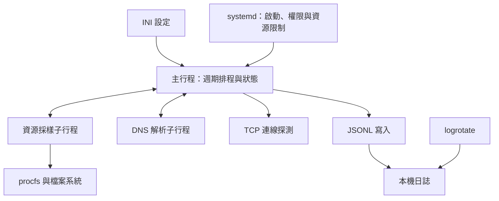

# Linux 輕量監控 Agent

以 Python 3 標準函式庫實作的 Linux 本機監控服務。預設每 30 秒收集 CPU、記憶體、Zombie、load average 與磁碟使用率，並檢查指定的內外網 TCP 端點，結果寫入本機 JSON Lines。

## 架構



- 主行程依序採樣、探測、寫入，不重疊執行輪次；保存上一輪 CPU 計數供差分使用。
- 資源 worker 期限 1 秒；每個 FQDN 的 DNS 解析預設 2 秒；每個端點所有解析位址共用 3 秒 TCP 預算。四端點約 17 秒工作預算，另有啟動、排程與同步 I/O 開銷，並非整輪硬上限。
- IP 直接連線；FQDN 先解析再連線。DNS 子行程超時可終止並回收。
- 每筆日誌重新 open／append／close，配合 logrotate rename 輪替。
- systemd 以非 root 專用帳號執行，限制權限、CPU、記憶體與 task 數；一般異常退出約 30 秒後重試，設定錯誤 exit 2 不重試。

## 環境與參數

需要 Python 3.8+、Linux procfs、systemd 與 logrotate。macOS 可執行本機測試，但不能以其結果代替 Linux 系統採樣或 systemd 驗證。

[範例設定](config/monitor-agent.conf) 的中央 IP 為 `192.168.1.254`、FQDN 為 `www.graid.com`。**TCP 埠 443 是待確認的預設值**；部署前須確認目標身分、實際服務埠與 DNS 映射。外部 `1.1.1.1:443`／`example.com:443` 是可替換的示範目標。

IP 與 FQDN 同時設定時分別探測，預設共四個端點，不掃描整個子網。

## 本機測試

不需要安裝 Python 第三方套件，測試使用 procfs fixture、loopback listener 與受控子行程。

```bash
PYTHONDONTWRITEBYTECODE=1 python3 -B -m unittest discover -s tests -v
python3 -B monitor_agent.py --config config/monitor-agent.conf --check-config
bash -n install.sh uninstall.sh
```

目前 31 項測試涵蓋 CPU 差分、記憶體、Zombie、分類、共享逾時預算、worker 回收、真實 loopback TCP、SIGTERM、CLI、心跳、日誌輪替與寫入失敗。

可在不安裝 systemd 的情況執行一輪。以下僅探測 loopback，父目錄必須可寫；若本機 port 1 恰有 listener，可能成功而非 refused。

```bash
printf '[agent]\nlog_path=/tmp/monitor-agent-demo.jsonl\nheartbeat_every_cycles=1\n\n[thresholds]\n\n[network]\ndns_timeout_seconds=1\ntcp_timeout_seconds=1\n\n[internal]\ndest=127.0.0.1\nfqdn=\nport=1\n\n[external]\ndest=127.0.0.1\nfqdn=\nport=1\n' > /tmp/monitor-agent-demo.conf
python3 monitor_agent.py --config /tmp/monitor-agent-demo.conf --once
python3 tests/validate_log.py /tmp/monitor-agent-demo.jsonl
```

首次 CPU 無前輪基準時輸出 `null`；macOS 缺少 procfs 時資源欄位可能未知。`--once` 的 exit 0 表示事件寫入成功，資源與網路健康要讀取 `level`／`result`。

## 安裝與設定更新

在已確認的 Linux 主機上執行：

```bash
python3 monitor_agent.py --config config/monitor-agent.conf --check-config
sudo bash install.sh
sudo systemctl status monitor-agent.service
sudo journalctl -u monitor-agent.service -n 30 --no-pager
sudo tail -n 10 /var/log/monitor-agent/agent.jsonl
```

程式安裝於 `/opt/monitor-agent`，設定在 `/etc/monitor-agent/monitor-agent.conf`，日誌為 `/var/log/monitor-agent/agent.jsonl`。安裝建立非登入專用帳號，並 enable／restart 服務。

**重跑安裝保留既有設定。** 修改來源設定檔不會自動更新已安裝的 `/etc` 設定。修改現場設定後先驗證再 restart；不提供熱載入。

```bash
sudo /usr/bin/python3 /opt/monitor-agent/monitor_agent.py --check-config
sudo systemctl restart monitor-agent.service
```

自訂日誌路徑時，需同步調整目錄權限、systemd 的 ReadWritePaths 與 logrotate。安裝腳本只建立預設目錄；還需確認 logrotate 排程已啟用。

## 日誌與失敗分類

每行一個 UTF-8 JSON 物件，含 schema `v=1`、UTC `ts`、`host` 與 `event`。程式版本為 `1.1.0`。

| event | 內容 |
|---|---|
| resource | cpu_pct、mem_pct、zombie_count、load1、disk_pct、level |
| network | target、dest、fqdn、result、failure_type、latency_ms、detail、level |
| heartbeat | pid、uptime_s、version、cycle_ms、level |

網路分類包含 `ok`、`dns_resolution_error`、`tcp_connection_timeout`、`tcp_connection_refused`、`network_unreachable`、`tcp_reset`、`internal_error`。`latency_ms` 包含解析、子行程及 TCP 開銷，不能當作純網路 RTT。

CPU 以相鄰輪次差分計算；記憶體以 MemAvailable 推算；資源未知值為 null。門檻來自設定檔；資源 level 優先序為 error > warn > ok。心跳預設每 10 輪一次，僅表示流程與該筆寫入有進展，不能代表所有目標健康。

[日誌驗證器](tests/validate_log.py) 可檢查每個 event 的固定欄位、型別與列舉值。

## 測試證據與限制

`tests/evidence/` 包含五份匿名歷史 JSONL、兩份本機 CLI JSONL及匿名 Linux 輸出；識別資料已替換，量測值與事件時間保留，代稱並非實際測試地址。公開內容不包含原始私有備份、真實存取方式或匿名化對照表。

[本機回歸結果](tests/evidence/local-acceptance/result.json) 與 [測試輸出](tests/evidence/local-acceptance/unittest.log) 可直接查看。本機與保存的 Linux 結果分開解讀；公開版未重新執行遠端 systemd。

尚待完整驗證：Linux 資源高低負載／交叉比對、全部網路故障注入、一般崩潰與 OOM 重啟、卸載兩種模式、24 小時足跡、輪替排程、真實磁碟滿、實際中央端點與 50 台規模。

TCP 成功只代表握手成功，不驗證 TLS／HTTP 或主機身分。hidepid 完全隱藏的 PID 無法察覺，Zombie 零值不保證全主機無 Zombie。同步寫檔仍可能受慢磁碟影響，沒有 watchdog，也不逐筆 fsync。

## 卸載

```bash
sudo bash uninstall.sh
sudo bash uninstall.sh --purge-data
```

預設停止並停用服務，將程式、unit 與輪替設定移至垃圾桶，保留設定、日誌及服務帳號。`--purge-data` 另將設定與日誌移至垃圾桶；兩種模式皆保留帳號。需要 `trash-put` 或 `gio trash`，沒有永久刪除回退。

公開儲存庫排除 `doc/`、`docs/`、Python 快取、虛擬環境、壓縮交件包與本機打包／驗收報告。
